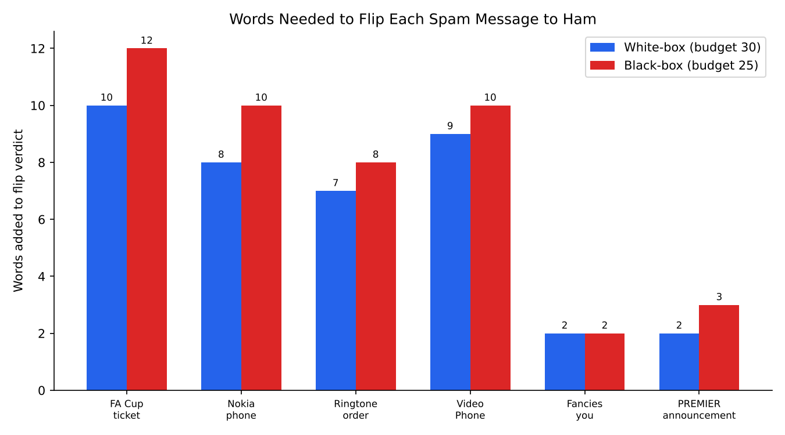
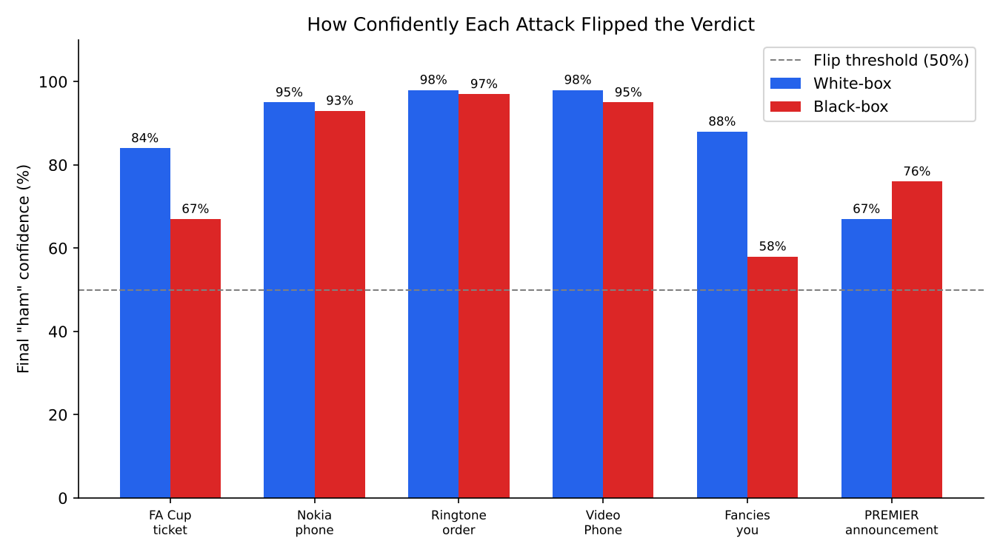
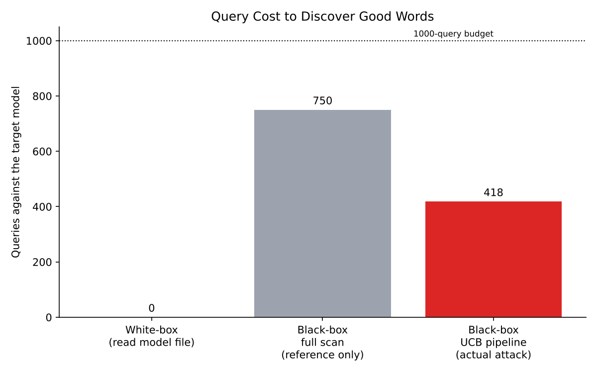

# Good Word Attacks on a Naive Bayes Spam Filter

Two notebooks, one attack, two levels of access. Both show how to make a trained spam filter call an obviously spam message "ham" by appending a handful of ordinary, legitimate sounding words to it, without touching, removing, or reordering a single word of the original message.

| Notebook | Access level | What it shows |
|---|---|---|
| [`0_goodword_whitebox.ipynb`](./0_goodword_whitebox.ipynb) | Full access to the trained model | Read the model's own weights to find good words instantly |
| [`1_goodword_blackbox.ipynb`](./1_goodword_blackbox.ipynb) | Query access only (predict API) | Discover the same kind of words through budgeted trial and error |

Same target filter, same six spam messages, same dataset ([SMS Spam Collection](https://archive.ics.uci.edu/dataset/228/sms+spam+collection)) in both notebooks, so the results below are directly comparable.

## The Core Idea

A Multinomial Naive Bayes spam filter doesn't read a message, it tallies one. Every word it knows carries a fixed vote toward "spam" or "ham," learned from training data, and the filter just sums the votes and goes with whichever side wins. It never checks whether those votes came from a coherent sentence. Drop a few ordinary, ham-leaning words onto the end of a spam message, and the vote total shifts without a single word of the actual spam changing.

The two notebooks differ only in how the attacker finds those good words, not in why the attack works.

## Attack Comparison

| | White-Box | Black-Box |
|---|---|---|
| **Model access** | Full (the trained classifier object) | None - only a query(text) → spam_probability function |
| **How good words are found** | Read feature_log_prob_ directly and sort | Search: UCB1 multi-armed bandit over a candidate word list |
| **Candidate pool** | Entire model vocabulary (7,715 words) | 49 hand-picked candidate words |
| **Queries needed to rank words** | 0 (a matrix subtraction) | 338 (UCB) vs. 750 for an exhaustive scan of the same pool |
| **Word budget per message** | 30 | 25 |
| **Messages flipped to ham** | 6 / 6 | 6 / 6 |
| **Average words needed per flip** | 6.3 | 7.5 |
| **Strongest word found** | `lor` (vote strength 4.27) | `cos` (UCB reward 0.2478) |
| **Combination search** | Not needed | Tested — synergy is ~0, confirming the model is purely additive |
| **Total pipeline cost** | Trivial (one-time model read) | 418 real queries used out of a 1,000-query budget |

## Visual Comparison

**Words needed to flip each target message:**

**Resulting confidence in the "ham" verdict:**

The black box attack lands closer to the 50% flip threshold on a couple of messages (e.g. "Fancies you" at 58%) since its word ranking is approximate rather than exact while a white box attacker who has the real weights can push the verdict further for the same or fewer words.

**Query cost to discover good words, three ways:**

The exhaustive scan (test every candidate against every message) is the reference ceiling which is accurate, but unaffordable at scale and included only for comparison. UCB1 gets within one query in ten of the exhaustive scan's ranking quality at under half the cost, which is the realistic approach when working against a live, rate-limited API.

## Key Takeaways

- **The vulnerability lives in the model's architecture, not in information leakage.** Naive Bayes' additive scoring is exploitable whether or not the attacker can see the weights. Hiding the model only raises the cost of the attack (a few hundred queries), it doesn't close the hole.
- **Combination search only pays off against non-additive models.** For MultinomialNB, `impact(w1 + w2)` is always exactly `impact(w1) + impact(w2)` by construction, so testing word pairs wastes queries. Against transformers, tree ensembles, or models with n-gram features, the same technique would surface real synergy worth exploiting.
- **The real defense is the query budget, not obscurity.** A 100-query session budget makes this kind of discovery infeasible; a 1,000-query budget does not (see each notebook's *Defences* section for the full list of mitigations).

## On a Live Engagement

The first thing I would do against a commercial spam API is figure out what it will tell me for free. A single well-formed request usually leaks more than people expect: `Server` and any `X-Powered-By`-style banners narrow down the stack, `WWW-Authenticate` tells me the auth model, and error responses to malformed input often include a version string or a framework name. Then I send a small burst (maybe five requests) and read the rate-limit headers: `X-RateLimit-Limit`, `X-RateLimit-Remaining`, `X-RateLimit-Reset`, `Retry-After` on a 429. If those are present, I know the budget almost exactly without spending any of it. If they're absent, I binary-search the limit: back off exponentially until I stop seeing 429s, then narrow. That's 15-20 queries to pin down a per-minute or per-hour ceiling, and it tells me whether the budget is per IP, per key, or per session.

Only once I know the budget do I spend it. I run a cheap pre-screen: a fixed sentence with one candidate word appended, repeated across maybe 10 candidates I've picked from domain knowledge, just to measure the score delta. That's 10-20 queries and it tells me whether the attack is even viable. If no single word moves the score more than noise, I stop and write that up, which is a perfectly good finding. If it does move, I use a local surrogate model (train a MultinomialNB on public SMS data, which is cheap and I already have) to pre-rank the full candidate list offline, then spend the live budget confirming the top ~30 and running UCB1 over them. 

This only works as well as the surrogate approximates the real target. If the production model uses different features (char n-grams, embeddings) or was trained on a very different corpus, the offline ranking may not transfer, and that's something you find out from the live confirmation step, not before it.

And before any of this, the scope document needs to state the query budget in writing — "up to N requests against the production endpoint" — because the whole attack is about staying under it, and you don't want to find out where the line is by crossing it.

## References

- Lowd, D. & Meek, C. (2005) — [Good Word Attacks on Statistical Spam Filters](https://personal.utdallas.edu/~mxk055100/courses/dmsec_files/125.pdf), CEAS 2005
- Auer, P., Cesa-Bianchi, N. & Fischer, P. (2002) — [Finite-time Analysis of the Multiarmed Bandit Problem](https://link.springer.com/article/10.1023/A:1013689704352), Machine Learning 47:235-256
- Almeida, T.A., Gomez Hidalgo, J.M. & Yamakami, A. (2011) — [Contributions to the Study of SMS Spam Filtering](https://archive.ics.uci.edu/dataset/228/sms+spam+collection), DOCENG'11
- MITRE ATLAS — [AML.T0015, Evade AI Model](https://d3fend.mitre.org/offensive-technique/attack/AML.T0015/) · [AML.T0043, Craft Adversarial Data](https://d3fend.mitre.org/offensive-technique/attack/AML.T0043/)
- OWASP ML Security Top 10 — [ML01:2023, Input Manipulation Attack](https://owasp.org/www-project-machine-learning-security-top-10/docs/ML01_2023-Input_Manipulation_Attack)
